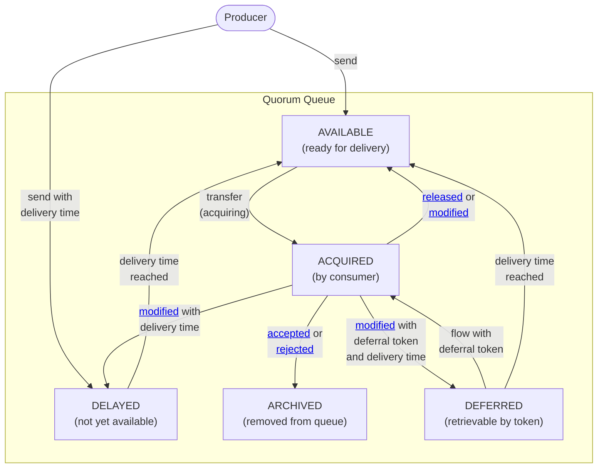
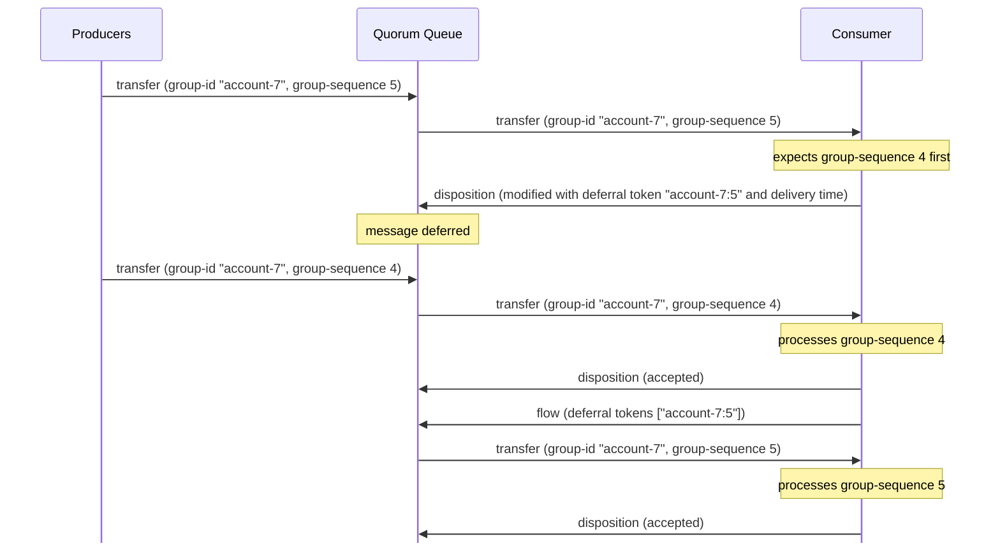
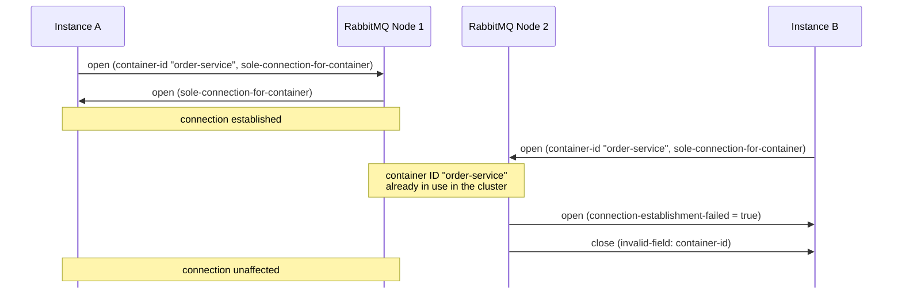
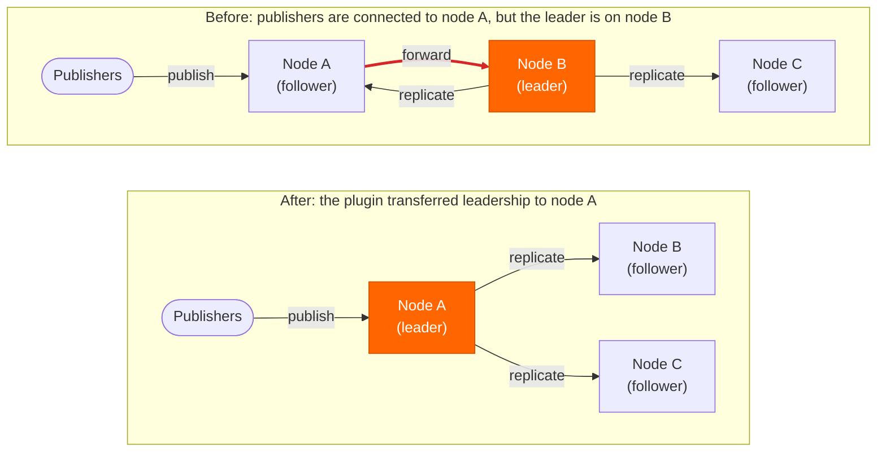
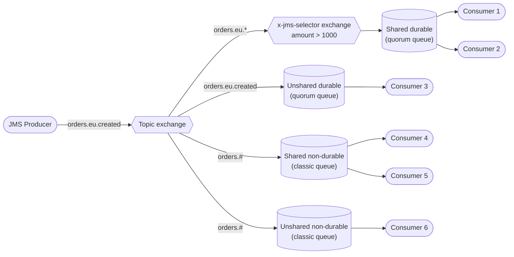
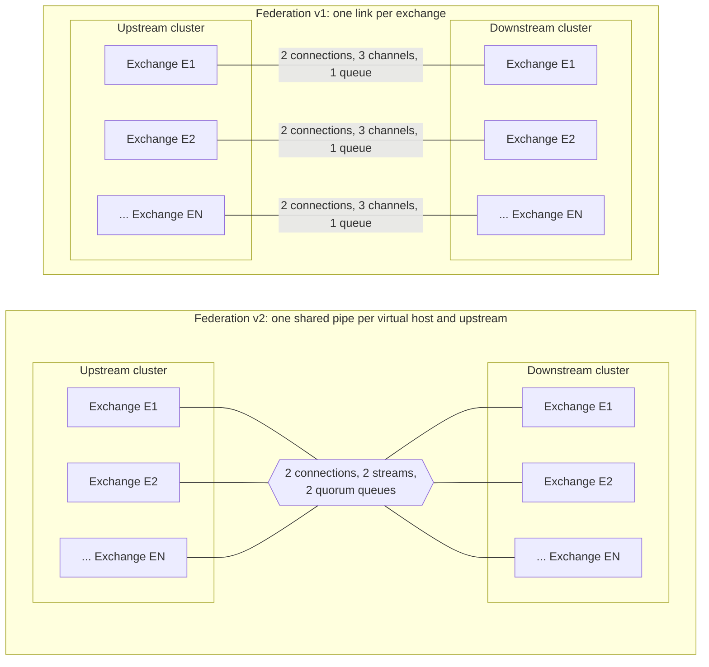
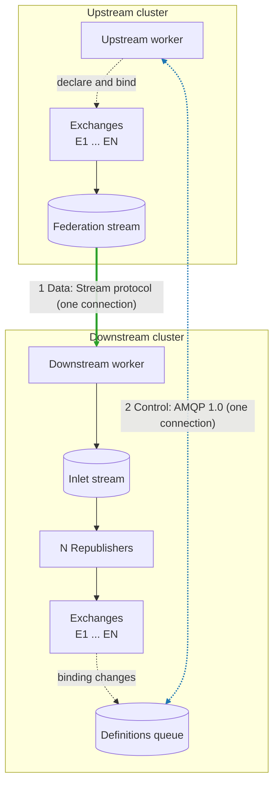

RabbitMQ 4.4 expands what you can do with quorum queues and JMS.
This post explores the release's highlights and what they mean for your enterprise applications.

<!-- truncate -->

Major enhancements to the open-source broker include:
* [Quorum Queue features](#quorum-queue-features)
    * [Delayed messages](#delayed-messages)
    * [Deferred messages](#deferred-messages)
    * [Availability zone-aware member placement](#az-aware-placement)
* [Erlang 29 and post-quantum TLS](#erlang-29)
* [Native STOMP](#native-stomp)
* [AMQP 1.0 connection uniqueness](#connection-uniqueness)

We are also introducing the following new enterprise features in [VMware Tanzu RabbitMQ](https://www.vmware.com/products/app-platform/tanzu-data-intelligence/rabbitmq):
* [Automatic quorum queue leader migration](#leader-migration)
* [JMS topics over AMQP 1.0](#jms-topics)
    * [The RabbitMQ AMQP JMS client](#jms-client)
    * [`noLocal` subscriptions](#jms-no-local)
    * [Client ID uniqueness](#jms-client-id)
* [Exchange federation v2](#exchange-federation-v2)

## Open-Source RabbitMQ

### Quorum Queue Features

[Quorum queues](/docs/quorum-queues) are the recommended queue type for data safety.
RabbitMQ 4.3 introduced [delayed retries](/blog/2026/04/23/rabbitmq-4.3-release#delayed-retries), [32 strict priority levels](/blog/2026/04/23/rabbitmq-4.3-release#32-message-priorities), and [per-queue consumer timeouts](/blog/2026/04/23/rabbitmq-4.3-release#consumer-timeouts).
RabbitMQ 4.4 extends quorum queues with two more ways of holding messages back.

#### Three Kinds of Message Delays {#message-delays}

"Delaying a message" can mean different things.
The variants differ in who decides on the delay, when the decision is made, and where the message waits in the meantime:

| | Who decides | When | Where the message waits | Available in |
| :--- | :--- | :--- | :--- | :--- |
| **Delayed message** | Producer | When producer sends the message | Inside the queue, not yet available to consumers | Quorum queues, **new in 4.4** |
| **Delayed retry** | Consumer | When consumer settles the message | Inside the queue, not yet available to consumers | [Quorum queues since 4.3](/blog/2026/04/23/rabbitmq-4.3-release#delayed-retries) |
| **Deferred message** | Consumer | When consumer settles the message | Inside the queue, until explicitly retrieved by a consumer using its deferral token | Quorum queues, **new in 4.4** |

AMQP 1.0 defines three [message states](https://docs.oasis-open.org/amqp/core/v1.0/os/amqp-core-messaging-v1.0-os.html#section-distribution-nodes) at a queue: `AVAILABLE`, `ACQUIRED`, and `ARCHIVED`.
The following diagram extends these state transitions with two additional states supported by quorum queues:



#### Delayed Messages

With RabbitMQ 4.4, a producer can set a future delivery time on a message.
The quorum queue stores the message immediately, but the message becomes available to consumers only once that time is reached.

Typical use cases include:
* **Business workflows:** "Send a reminder in 24 hours" or "Cancel the reservation if it's still unpaid in 15 minutes."
* **Temporal decoupling:** Events that must not be processed before a certain point in time.

Routing happens immediately when the message is sent. As a result:
* **Simpler and safer semantics:** The target quorum queue [confirms](/docs/confirms) the message to the producer once it has safely replicated the message. There is no later RabbitMQ-internal re-publish that could fail because a target queue is unavailable or has reached its length limit.
* **No extra entities:** No plugin, exchange type, or queue argument is needed. Any quorum queue supports delayed messages.

To delay a message, set `x-opt-delivery-time` to an absolute Unix timestamp in milliseconds.
With [AMQP 1.0](/docs/amqp), this is a message annotation defined by the OASIS AMQP extension [Scheduling Message Delivery by Store and Forward Intermediaries](https://groups.oasis-open.org/higherlogic/ws/public/download/65347/schdmsg-v1.0-wd02.pdf/latest):

```java
long deliveryTime = Instant.now().plus(Duration.ofMinutes(15)).toEpochMilli();

Message message = publisher.message(body)
    .annotation("x-opt-delivery-time", deliveryTime);
publisher.publish(message, context -> { /* confirmation */ });
```

Delayed messages count toward the queue's [length limit](/docs/maxlength) and appear in the **Delayed** column of the Management UI.

#### Deferred Messages

Sometimes a consumer receives a message that it can't process *yet*. The problem isn't a transient failure; the message is just early.

Consider events that must be processed in order, for example all events of a bank account.
AMQP 1.0 [message properties](https://docs.oasis-open.org/amqp/core/v1.0/os/amqp-core-messaging-v1.0-os.html#type-properties) provide the `group-id` and `group-sequence` fields for this purpose.
If multiple producers send events for the same account, a consumer might receive event 5 of group `account-7` before event 4.

A delayed retry doesn't fit here: the consumer doesn't know *when* event 4 will arrive, only that it will recognize the moment when it does.

RabbitMQ 4.4 introduces **deferred messages** for quorum queues: the consumer defers the message under a client-provided **deferral token** (e.g. `account-7:5`) and explicitly retrieves it later using that same token.
Because the token can be derived from the message itself, the consumer does not need to remember any broker-assigned sequence number.
This implements the [Resequencer](https://www.enterpriseintegrationpatterns.com/patterns/messaging/Resequencer.html) integration pattern without any external store:



The delivery time supplied when deferring event 5 is a safety net: if event 4 never arrives, event 5 becomes available again at that time. The consumer then decides how to handle the gap.

Other use cases include human-in-the-loop approvals and long-running business processes that wait for an external callback.

The feature is available over AMQP 1.0:
1. **Defer:** The consumer settles the message with the [modified outcome](https://docs.oasis-open.org/amqp/core/v1.0/os/amqp-core-messaging-v1.0-os.html#type-modified), setting two [message annotations](https://docs.oasis-open.org/amqp/core/v1.0/os/amqp-core-messaging-v1.0-os.html#type-message-annotations):
    * `x-opt-deferral-token`: a string of up to 256 bytes.
    * `x-opt-delivery-time`: a deadline. If the message is never retrieved, it becomes available to all consumers at this time, so no message gets stuck forever.
2. **Retrieve:** Any consumer attached to the queue retrieves deferred messages by sending a [flow frame](https://docs.oasis-open.org/amqp/core/v1.0/os/amqp-core-transport-v1.0-os.html#type-flow) whose `rabbitmq:deferral-tokens` property lists one or more tokens. Retrieved messages are transferred to the consumer ahead of the queue's backlog of available messages.

Multiple messages can be deferred under the same token. They are transferred oldest first.
Deferred messages are replicated like any other quorum queue message, so they survive node failures.

:::note

If a consumer cannot process *any* messages, for example because its database is offline, neither delays nor deferrals are the right tool.
Pause the consumer instead and resume it once the dependency is back.

:::

#### Availability Zone-Aware Member Placement {#az-aware-placement}

Consider a cluster of five RabbitMQ nodes deployed across three availability zones (AZs), with two nodes in AZ1, two in AZ2, and one in AZ3.
A quorum queue with three members stays available as long as two of its members are reachable.
Until now, RabbitMQ placed members without knowing which zone a node runs in, so a queue could end up with two members in AZ1 and one in AZ2.
If AZ1 then went down, the queue lost its quorum and became unavailable, even though the cluster spans three zones.

RabbitMQ 4.4 can place quorum queue members across zones:

| | AZ1 (2 nodes) | AZ2 (2 nodes) | AZ3 (1 node) | If AZ1 goes down |
| :--- | :---: | :---: | :---: | :--- |
| **Before 4.4** (possible placement) | 2 members | 1 member | – | 1 member online: queue unavailable |
| **4.4 with AZ-aware placement** | 1 member | 1 member | 1 member | 2 members online: queue available |

Each node declares its zone using a [node tag](/docs/configure#node-tags), and quorum queues spread their members evenly across the tag's values:

```ini
# rabbitmq.conf on every node (the zone value differs per node)
node_tags.az = az1

# spread quorum queue members across distinct values of the "az" tag
quorum_queue.member_placement_tag = az
```

The tag is generic: it can be called anything and describe any failure domain, for example `dc` for data centers or `rack` for server racks.

AZ-aware placement can also be enabled per queue using the `member-placement-tag` [policy](/docs/policies) key or the `x-member-placement-tag` queue argument.
`rabbitmq-queues quorum_status` shows the zone of each member.

### Erlang 29 and Post-Quantum TLS {#erlang-29}

RabbitMQ 4.4 supports [Erlang/OTP 29](/docs/which-erlang).

The most relevant improvement for RabbitMQ users is post-quantum cryptography in [TLS](/docs/ssl).
Erlang/OTP 28 added support for post-quantum algorithms, but did not prefer them.
In Erlang/OTP 29, the hybrid key exchange group `x25519mlkem768` (classical X25519 combined with the post-quantum ML-KEM-768) is the most preferred TLS 1.3 key exchange group by default.
When negotiated with a compatible client, this protects encrypted traffic recorded today against future decryption by quantum computers ("harvest now, decrypt later").
Erlang/OTP 29 also prefers post-quantum ML-DSA signatures if a matching certificate is configured.

Post-quantum algorithms require Erlang/OTP's `crypto` application to be linked against OpenSSL 3.5 or later.

### Native STOMP

RabbitMQ 3.12 introduced [Native MQTT](/blog/2023/03/21/native-mqtt) and RabbitMQ 4.0 introduced [Native AMQP 1.0](/blog/2024/08/05/native-amqp).
Before these releases, the MQTT and AMQP 1.0 plugins translated every client operation into AMQP 0.9.1 via an internal AMQP 0.9.1 client, with a set of extra Erlang processes for every connection.
Removing that proxy layer reduced memory usage and increased throughput significantly.

RabbitMQ 4.4 completes this journey for [STOMP](/docs/stomp).
The STOMP plugin no longer depends on the internal AMQP 0.9.1 client. Instead, STOMP connections interact with [exchanges](/docs/exchanges) and [queues](/docs/queues) directly.
Every STOMP connection, including [Web STOMP](/docs/web-stomp), now requires fewer Erlang processes and less memory.

### AMQP 1.0 Connection Uniqueness {#connection-uniqueness}

Some applications need a single active connection, for example to own a subscription exclusively or to avoid two instances processing the same workload.

RabbitMQ 4.4 implements the OASIS AMQP [Enforcing Connection Uniqueness](https://docs.oasis-open.org/amqp/soleconn/v1.0/soleconn-v1.0.pdf) extension, also known as "sole connection".
An [AMQP 1.0](/docs/amqp) client can request that at most one connection with its [container ID](https://docs.oasis-open.org/amqp/core/v1.0/os/amqp-core-transport-v1.0-os.html#type-open) exists per [virtual host](/docs/vhosts) across the entire cluster.
If a second connection with the same container ID is opened, RabbitMQ either refuses the new connection or closes the existing one, depending on the policy requested by the client.

The following diagram shows the default `refuse-connection` policy. Even though instance B connects to a different node, RabbitMQ refuses its connection because instance A already uses the same container ID:



Container IDs are tracked in a dedicated Raft-replicated store, so enforcement works across all connected cluster nodes.
Connections that don't request the capability are not affected.

---

## VMware Tanzu RabbitMQ

[VMware Tanzu RabbitMQ](https://www.vmware.com/products/app-platform/tanzu-data-intelligence/rabbitmq) is the commercial edition of RabbitMQ, layering enterprise-grade, closed-source plugins over the open-source core. Release 4.4 adds the following extensions.

### Automatic Quorum Queue Leader Migration {#leader-migration}

Quorum queues are built on the [Raft](https://raft.github.io/) consensus algorithm.
Raft keeps all members of a queue consistent by replicating a single log: every member applies the same operations, such as enqueues and acknowledgements, in the same order.
That order is decided by a single member, the leader. This is why every message published to a quorum queue is first sent to its leader, which appends the message to its log and replicates it to the followers.

If a publisher is connected to a RabbitMQ node that doesn't host the leader, every message makes an extra hop across the cluster before it is replicated:



This happens frequently in practice: load balancers distribute client connections across nodes, and leaders end up wherever elections place them after restarts or upgrades.
The existing [`rabbitmq-queues rebalance`](/docs/quorum-queues#member-rebalancing) command balances the *number* of leaders per node, but it doesn't know where the traffic comes from.

The new leader migration plugin in Tanzu RabbitMQ 4.4 places leaders based on traffic:
* Each quorum queue tracks how many bytes are published to it via each node.
* Periodically, each node checks the queues it leads. If another member's node receives significantly more ingress than the current leader's node, the plugin transfers leadership there.
* Warm-up periods, per-queue cooldowns, and a rate limit on transfers prevent leaders from flapping when traffic patterns briefly change.

:::tip

Placing the leader where the messages enter the cluster brings the following benefits, without any manual intervention:
* **Less network traffic:** For a three-member quorum queue, each published message crosses the network between nodes twice (replication to two followers) instead of three times (forwarding plus replication).
* **Lower publish latency:** Messages skip one network hop before they are replicated.
* **Lower infrastructure costs:** Cloud providers often charge egress or data transfer fees for traffic between availability zones or regions. Less traffic directly reduces these costs.
* **Stretched clusters:** The benefits are especially relevant for [clusters spanning multiple availability zones or data centers](/docs/clustering#wan), where every network hop between nodes is slower and more expensive.

Because message payloads can be large and published at high throughput, the savings in bandwidth and cost, as well as the gains in performance, can be substantial.

:::

To enable it:

```bash
rabbitmq-plugins enable rabbitmq_leader_migration
```

### JMS Topics over AMQP 1.0 {#jms-topics}

Tanzu RabbitMQ 4.3 introduced the [JMS queue type](/blog/2026/04/23/rabbitmq-4.3-release#jms-queue-type) for [point-to-point messaging](https://jakarta.ee/specifications/messaging/3.1/jakarta-messaging-spec-3.1.html#jakarta-messaging-point-to-point-model) with [message selectors](/blog/2026/04/23/rabbitmq-4.3-release#jms-message-selectors), [queue browsers](/blog/2026/04/23/rabbitmq-4.3-release#queue-browser), and [delivery delay](/blog/2026/04/23/rabbitmq-4.3-release#message-delivery-delay).
Tanzu RabbitMQ 4.4 completes the picture with **JMS topics** ([publish/subscribe](https://jakarta.ee/specifications/messaging/3.1/jakarta-messaging-spec-3.1.html#jakarta-messaging-publishsubscribe-model)) over AMQP 1.0, another milestone towards turning RabbitMQ into a JMS-native broker.

Supported features include:
* All four subscription types: [unshared non-durable](https://jakarta.ee/specifications/messaging/3.1/jakarta-messaging-spec-3.1.html#unshared-non-durable-subscriptions), [shared non-durable](https://jakarta.ee/specifications/messaging/3.1/jakarta-messaging-spec-3.1.html#shared-non-durable-subscriptions), [unshared durable](https://jakarta.ee/specifications/messaging/3.1/jakarta-messaging-spec-3.1.html#unshared-durable-subscriptions), and [shared durable](https://jakarta.ee/specifications/messaging/3.1/jakarta-messaging-spec-3.1.html#shared-durable-subscriptions).
* Durable subscriptions are backed by [quorum queues](/docs/quorum-queues), so they survive node failures.
* [Message selectors](https://jakarta.ee/specifications/messaging/3.1/jakarta-messaging-spec-3.1.html#message-selector) on subscriptions, evaluated by the broker **before** a message is enqueued, so a subscription queue only ever stores matching messages. The `rabbitmq_jms` plugin provides a new exchange type, `x-jms-selector`, for this purpose. RabbitMQ creates and deletes these exchanges automatically together with the subscription.
* [Topic](/docs/exchanges#topic) wildcards: `*` matches exactly one word and `#` matches zero or more words.
* [Temporary topics](https://jakarta.ee/specifications/messaging/3.1/jakarta-messaging-spec-3.1.html#temporary-topics) for request/reply.

The following example shows one subscription of each type on the topic exchange. Shared subscriptions have multiple consumers that share the messages of one subscription queue:



#### The RabbitMQ AMQP JMS Client {#jms-client}

The new [RabbitMQ AMQP JMS client](https://github.com/rabbitmq/rabbitmq-amqp-jms-client) is an open-source fork of [Apache Qpid JMS](https://github.com/apache/qpid-jms).
It is the recommended JMS client for Tanzu RabbitMQ.
The fork fixes several issues uncovered by running the Jakarta Messaging TCK against RabbitMQ.

#### `noLocal` Subscriptions {#jms-no-local}

A JMS consumer created with `noLocal = true` does not receive messages published with the same client ID.
This is useful when an application both publishes and subscribes to the same topic, for example to sync state between instances, and must not process its own events.
The [old JMS client over AMQP 0.9.1](https://rabbitmq.github.io/rabbitmq-jms-client/3.x/snapshot/htmlsingle/index.html#limitations) could not support `noLocal` correctly. Over AMQP 1.0, the broker filters these messages out at routing time.

#### Client ID Uniqueness {#jms-client-id}

JMS applications also benefit from the new [connection uniqueness](#connection-uniqueness) enforcement in open-source RabbitMQ 4.4.
The JMS specification requires that only one connection with a given client ID exists at any time. Applications rely on this to make sure that a single instance owns a durable subscription.
The old JMS client couldn't enforce this either. With the AMQP 1.0 JMS client, a second connection with the same client ID now fails with `InvalidClientIDException`.

Here is how these features look in practice:

```java
ConnectionFactory factory = new JmsConnectionFactory(
    "user", "password", "amqp://localhost:5672?jms.clientID=order-service");

try (JMSContext context = factory.createContext()) {
    Topic created = context.createTopic("orders.eu.created");

    // Shared durable subscription with a broker-side selector
    JMSConsumer bigOrders = context.createSharedDurableConsumer(
        created, "big-orders", "amount > 1000");

    // Non-durable wildcard subscription ignoring messages published with this client ID
    JMSConsumer others = context.createConsumer(
        context.createTopic("orders.*.created"), null, true);

    TextMessage msg = context.createTextMessage("order 42");
    msg.setIntProperty("amount", 5000);
    // bigOrders receives the message, others does not (noLocal)
    context.createProducer().send(created, msg);
}
```

### Exchange Federation v2

[Exchange federation](/docs/federated-exchanges) replicates messages published to an exchange in one cluster to an exchange in another cluster, typically across regions or WAN links.
Only messages that match bindings in the downstream cluster cross the network.

The existing federation plugin (v1) allocates resources per federated exchange: several [connections](/docs/connections) and [channels](/docs/channels), plus a queue on the upstream cluster.
This works well for tens of exchanges, but some deployments federate an exchange per tenant, device, or business entity. With hundreds or thousands of exchanges, the overhead adds up to hundreds or thousands of connections.

Tanzu RabbitMQ 4.4 introduces exchange federation v2, a new plugin designed for this scale.
Instead of per-exchange links, v2 shares one link per virtual host and upstream, regardless of how many exchanges are federated:



Internally, v2 uses two connections between the clusters:



* **Data path:** Messages flow over the efficient [RabbitMQ Stream protocol](/docs/stream) from a [stream](/docs/streams) on the upstream into a replicated stream on the downstream, which feeds the federated exchanges.
* **Control path:** Binding changes on the downstream are recorded in a quorum queue and applied asynchronously to the upstream over AMQP 1.0. A periodic reconciliation repairs any drift.

The resources used across both clusters for N federated exchanges of one virtual host and upstream, with the default `on-confirm` mode:

| | Federation v1 | Federation v2 |
| :--- | :--- | :--- |
| Connections | ~2N | 2 (regardless of N) |
| Channels | ~3N | 0 |
| Internal queues and streams | N queues | 2 streams, 2 quorum queues |
| **Example: N = 1,000** | ~2,000 connections, ~3,000 channels, 1,000 queues | 2 connections, 2 streams, 2 quorum queues |
| **Example: N = 10,000** | ~20,000 connections, ~30,000 channels, 10,000 queues | 2 connections, 2 streams, 2 quorum queues |

With v2, only a lightweight republisher Erlang process is added per federated exchange on the downstream.

Further benefits include:
* **Data safety:** Replicated streams and quorum queues on both sides. Messages are delivered at least once by default.
* **High availability:** Exactly one active link per virtual host and upstream, with automatic failover to another node within seconds.
* **Efficient binding propagation:** v1 makes one synchronous round trip to the upstream cluster for every binding change and replays all bindings on every reconnect. v2 writes binding changes to a local queue, applies them asynchronously, and periodically reconciles the whole topology.
* **Lower memory footprint:** v1 starts more than ten Erlang processes per federated exchange on the downstream cluster. v2 starts one lightweight republisher.
* **Fast recovery:** After a node or link failure, v2 resumes message transfer from its stored stream position.
* **Simpler operations:** Restarting a node, for example during a rolling upgrade, affects one link per virtual host and upstream instead of thousands of per-exchange links that all have to be stopped, restarted on another node, and set up again. A small, fixed number of connections is also easier to monitor and troubleshoot.
* **Observability:** Dedicated Management UI pages, CLI commands, and Prometheus metrics.

Federation v2 is configured with its own upstream parameters and policies.
The original exchange federation plugin (v1) remains a mature choice for deployments with a moderate number of exchanges.

## Summary

We are thrilled for you to experience RabbitMQ 4.4 and the new VMware Tanzu RabbitMQ extensions.
We welcome your feedback via [GitHub Discussions](https://github.com/rabbitmq/rabbitmq-server/discussions).
For support and commercial extensions, please reach out to our sales team via [VMware Tanzu RabbitMQ](https://www.vmware.com/products/app-platform/tanzu-data-intelligence/rabbitmq).
